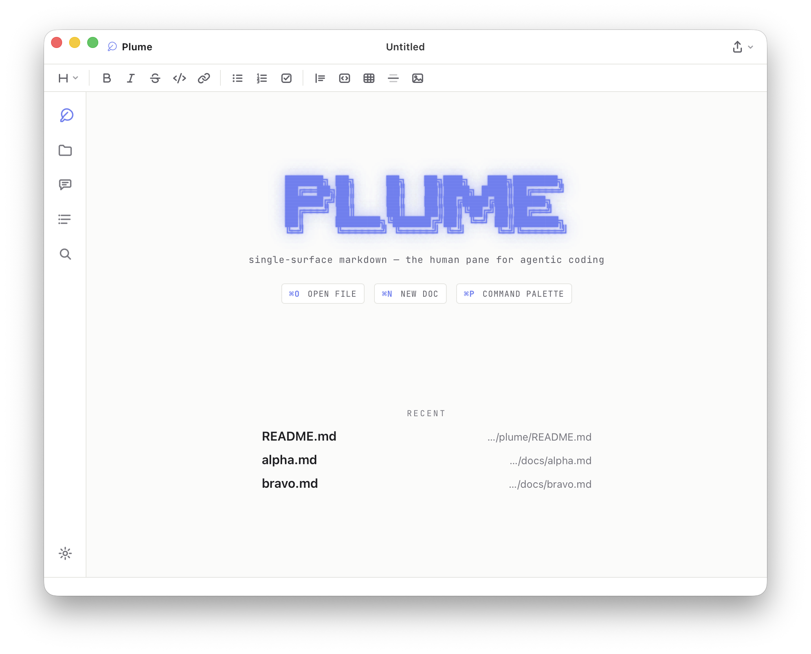

# Plume

A fast, single-surface Markdown editor for macOS. It renders like a document, saves like a text file, and stays out of the way while an AI agent writes alongside you.




Plume is the human pane for agentic coding. The terminal is where your agent writes. Plume is where you read, steer, and ship what it produces.

It shows finished Markdown, not syntax. Bold is bold, headings are sized, links show their text, checkboxes are checkboxes. The syntax marks (`**`, `#`, `` ` ``, `[]()`) reveal only on the line your cursor is on. What lands on disk is exactly what you typed: plain UTF-8 Markdown, no wrapper, no lock-in.

Built on Tauri v2 (native WKWebView plus Rust) and CodeMirror 6. About 4.7 MB, not 449.

## The agent companion

This is the part that sets Plume apart. It is a first-class surface for the files an agent produces, and a two-way channel back to the agent.

- **Reads every file an agent touches:** Markdown rendered, code and config highlighted, JSONL transcripts as role-tagged records, diffs, logs that tail-follow, CSV as tables, Mermaid as diagrams. One window for the whole workspace.
- **Live auto-reload:** the open document refreshes the instant the agent writes it, scroll kept. Unsaved edits raise a "changed on disk" prompt instead of a silent clobber.
- **`plume` CLI:** `plume plan.md`, `plume report.md --line 42`, `plume .` for a folder, `plume --new`. Install it from File ▸ Install 'plume' Shell Command. It talks to a running Plume over `~/.plume/plume.sock` and launches one if needed.
- **MCP server** (`plume-mcp`, over stdio): works with Claude Code, Codex, and Gemini. `claude mcp add plume -- plume-mcp`. The agent opens files, reads your selection, reads your typed directives, and writes revisions.
- **Directed steer loop:** select a passage, press ⌘J, give it a verdict. Revise, approve, reject, question, or pin. The agent reads the directives through `get_annotations`, revises, and Plume shows each change as an accept/reject diff tied to its directive. Code review, for the prose your agents write.
- **Deep links:** `plume://open?path=/abs/file.md&line=12`.

Setup and drop-in agent config live in [docs/agent-setup.md](docs/agent-setup.md).

## Highlights

- **Single-surface live preview:** marks reveal on the active line, the rest reads finished. Toggle raw syntax with ⌘⇧M.
- **Plain Markdown on disk:** UTF-8 `.md`, no database, no wrapper. Open it in anything.
- **First-keystroke autosave:** a new note is backed by a file from the first character you type, saved under `~/Documents/Plume/Autosave`. Scratch buffers are never lost.
- **Export & share:** copy as rich text or HTML, export to PDF, HTML, and Word, publish one-way to Google Docs.
- **Hardened:** a written threat model and a signed, notarized release. See [Security](#security).

## Quickstart

Requires Node, Rust, and the Tauri CLI.

```bash
npm install
npm run dev            # build the renderer and launch (Tauri dev)
```

Build a release app:

```bash
npm run tauri:build    # creates src-tauri/target/release/bundle/macos/Plume.app
```

Drag `Plume.app` to `/Applications`, then make it the default `.md` handler: right-click any `.md`, Get Info, Open With, Plume, Change All.

## Features

<details><summary><b>Editing & rendering</b></summary>

- Headings, bold, italic, strike, inline code, blockquotes, lists, code blocks, task lists with clickable checkboxes, horizontal rules.
- Links show their text; ⌘-click to follow. External URLs open in your browser, relative `.md` links in a new Plume window.
- Per-language highlighting inside code fences: JS/TS, Python, Bash, JSON, CSS, HTML, SQL, YAML, Rust, Go, C/C++, Java, PHP, XML.
- Live tables with column alignment and inline Markdown in cells. Click a rendered cell to edit it in place; Tab and Enter move between cells, and the Markdown source stays clean.
- Per-document settings via front matter: a leading `---` block can set `theme`, `font`, `width`, and `focus` for that document alone, leaving your global defaults untouched.
- KaTeX math, inline `$…$` and display `$$…$$`, with a heuristic that leaves `$5` and `$HOME` as literal text.
- Mermaid diagrams from ` ```mermaid ` fences, theme-aware.
- Outline panel (⌘⇧O), find and replace (⌘F), a formatting toolbar, and shortcuts (⌘B/I/E/K, ⌘1/2/3).
- Light, dark, and system themes. Font picker: Inter, SF Pro, New York, Charter, Iowan, JetBrains Mono.
- Focus mode (⌘⇧L), `==highlight==`, `> [!NOTE]` callouts, live word count and reading time.

</details>

<details><summary><b>Files, agent formats & navigation</b></summary>

- Folder sidebar (⌘⇧E), command palette (⌘P), search in folder (⌘⇧F).
- JSONL / NDJSON viewer for transcripts and eval data: collapsible, role-tagged records.
- Diff and patch viewer; log viewer with level highlighting, ANSI color, and tail-follow.
- CSV and TSV render as tables; a standalone `.mmd` renders as Mermaid. Toggle source and rendered with ⌘/.
- Sessions & Context (⌘⇧P): browse Claude Code sessions in `~/.claude/projects`, search transcripts, and open the folder's CLAUDE.md, AGENTS.md, or README.
- Images: paste, drop, or pick one, saved beside the file with a relative link.
- Link previews: a lone link renders as a card; an image URL displays inline.

</details>

## Security

Plume lets an agent read and write your files over a local socket and an MCP server. The agent connection is the security surface. The model is written down in [SECURITY.md](SECURITY.md) and enforced in both code and CI.

- **Three adversaries:** a prompt-injected agent holding a valid token, a hostile document, and a remote web page reaching the `plume://` handler. A token is not a person. Any control that needs a human keys on a human act (a native dialog, a launch argument), not on the caller holding a token.
- **Reads and writes stay in bounds:** every renderer and socket file command is scoped to files you opened. A deny list (credentials, `.env*`, `.git` internals, keys, shell history) overrides that scope for reads and writes alike. The path checked is the path used, resolved once, so a symlink swap cannot redirect it.
- **Nothing phones home:** export vets and inlines remote images through one Rust choke point, so neither the Word sidecar nor the PDF renderer ever reaches the network. Link previews use a pinned resolver and follow no redirects. A strict Content Security Policy leaves no `fetch()` behind the sanitizer.
- **Supply chain:** CI runs the full test suite, `cargo clippy -D warnings`, and `npm audit` plus `cargo audit`. The optional Node runtime download checks a build-pinned digest. The release build is Developer-ID signed and notarized.

We put the model through an adversarial review and several independent re-checks. If you find a gap, please open an issue.

## Architecture

Tauri v2: a native WKWebView plus a Rust binary, about 4.7 MB against Electron's roughly 449. The renderer is vanilla JavaScript on CodeMirror 6, running unchanged through a `window.plume` bridge (`tauri/tauri-bridge.js`) backed by the Rust commands in `src-tauri/`. A small Node sidecar handles Word and Google Docs export. Plume began on Electron; the Tauri port is complete and Electron has been removed.

## Development

```bash
npm install
npm run dev              # build the renderer and launch
npm run watch:renderer   # rebuild the renderer on change
npm test                 # node --test
```

Rust tests: `cargo test --manifest-path src-tauri/Cargo.toml`.

## License

MIT
